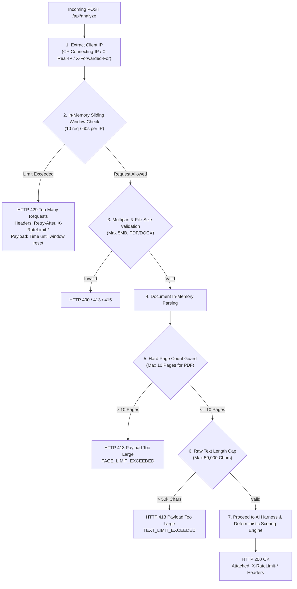
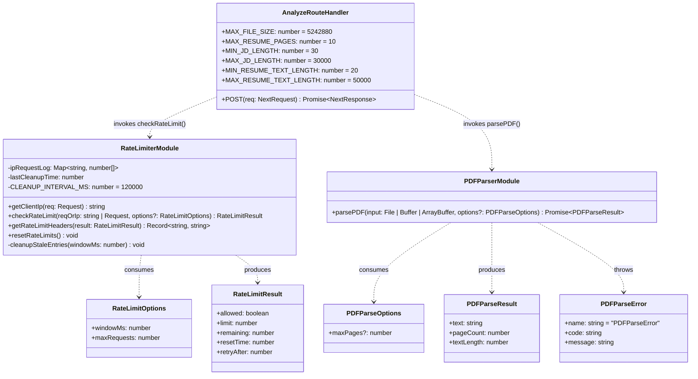
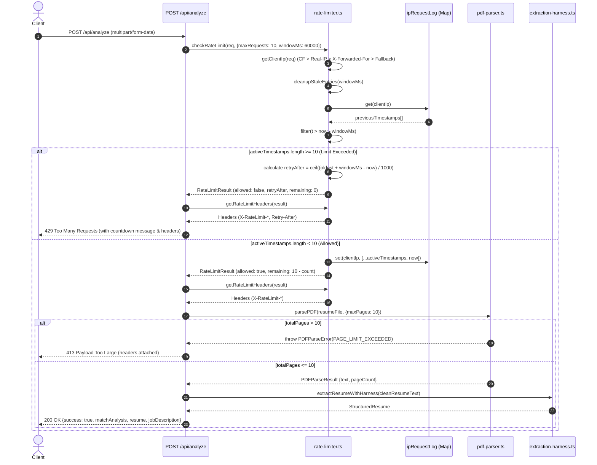

# 🛡️ API Rate Limiting & Resource Protection Implementation Plan

> **Component:** `/api/analyze` Security, Throttling & Memory Guard System  
> **Status:** Implemented & Verified (37/37 Tests Passing)  
> **Target Release:** v2.4+ Production Hardening  

---

## 📌 1. Executive Summary & Problem Statement

Prior to this hardening, the `/api/analyze` endpoint was completely unthrottled. While client-side validations existed on the web frontend, direct HTTP requests could:
1. **Spam resource-heavy endpoints:** The route orchestrates PDF parsing, multi-tier AI LLM extraction (Groq LPU / Gemini Flash), and deterministic matrix calculations. Unthrottled calls could exhaust free-tier LLM API quotas or spike server costs.
2. **Denial-of-Service via "PDF Bombs":** Users or bots could upload 200+ page books, dissertations, or scanned manuals disguised as resumes. Processing such documents in-memory caused significant memory pressure and blocked the Node.js event loop during AST extraction.
3. **Unbounded DOCX Text Injection:** Word documents lack explicit page headers; malicious payloads with millions of characters could overwhelm regex engines.

---

## 🏛️ 2. Architectural Blueprint & Request Flow



---

## 🔬 2.1 Low-Level Design (LLD) Class Model

The class diagram below specifies the structural types, modules, error taxonomies, and cross-module dependency contracts for the security and guard layer:



---

## 🔄 2.2 Low-Level Execution Sequence Diagram

The sequence diagram below illustrates the exact execution tracing, memory lookup, timestamp pruning math, error routing, and header composition:



---

## 📐 3. Technical Specifications & Guard Rails

### A. Sliding Window Log Rate Limiter
* **Algorithm:** Sliding-Window Log. Unlike a fixed-window counter, the sliding-window log evaluates the exact rolling timestamp threshold (`now - windowMs`), entirely eliminating edge-burst exploits (where an attacker makes 10 requests at 00:59 and 10 requests at 01:01).
* **Quota:** `10 requests` per `60,000 ms` (1 minute) per IP address.
* **Auto-Garbage Collection:** A background pruner purges inactive IP entries every 2 minutes or whenever the store exceeds 1,000 tracked keys, strictly bounding memory usage.

### B. Multi-Proxy IP Resolution Order
To prevent header spoofing and support various edge topologies (Cloudflare, Vercel, AWS CloudFront, Nginx):
1. `cf-connecting-ip` (Cloudflare authoritative header)
2. `x-real-ip` (Standard reverse proxy header)
3. `x-forwarded-for` (Comma-separated proxy chain; securely extracts the **first** client IP)
4. `forwarded` (RFC 7239 `for="..."` standard format)
5. `127.0.0.1` (Safe development fallback)

### C. Standard RFC Rate Limit Headers
Every response from `/api/analyze` (both successful and rejected) includes rate-limit metadata:
* `X-RateLimit-Limit`: Maximum requests permitted in the window (e.g. `10`).
* `X-RateLimit-Remaining`: Remaining request quota for the current IP.
* `X-RateLimit-Reset`: Unix timestamp (in seconds) when the oldest request drops out of the sliding window.
* `Retry-After`: (Included only on HTTP 429) Number of integer seconds the client must wait before retrying.

### D. Hard Document Constraints
| Parameter | Threshold | Rejection Code | Rationale |
| :--- | :--- | :--- | :--- |
| **Max File Size** | `5 MB` (`5,242,880 B`) | HTTP `413` | Prevents oversized uploads from saturating network buffers. |
| **Max Resume Pages** | `10 pages` | HTTP `413` | Industry-standard resumes are 1–4 pages; >10 pages indicates books/papers. |
| **Max Extracted Text** | `50,000 characters` | HTTP `413` | Prevents regex catastrophic backtracking and context overflow in DOCX payloads. |
| **Min Readable Text** | `20 characters` | HTTP `422` | Catches scanned image PDFs without OCR selectable text. |
| **Min Job Description** | `30 characters` | HTTP `400` | Ensures sufficient technical context for alignment analysis. |
| **Max Job Description** | `30,000 characters` | HTTP `400` | Prevents prompt injection and excessive token consumption. |

---

## 💻 4. Core Implementation Blueprint

### 1. `src/lib/security/rate-limiter.ts`
Provides the in-memory store, sliding window evaluator, header builder, and client IP resolver:
```typescript
export interface RateLimitOptions {
  windowMs: number;
  maxRequests: number;
}

export interface RateLimitResult {
  allowed: boolean;
  limit: number;
  remaining: number;
  resetTime: number;
  retryAfter: number;
}

export function checkRateLimit(
  reqOrIp: Request | NextRequest | string,
  customOptions?: Partial<RateLimitOptions>
): RateLimitResult;

export function getRateLimitHeaders(result: RateLimitResult): Record<string, string>;
export function getClientIp(req: Request | NextRequest): string;
export function resetRateLimits(): void; // Unit testing hook
```

### 2. `src/lib/parser/pdf-parser.ts`
Enhanced with optional `maxPages` configuration and distinct `PAGE_LIMIT_EXCEEDED` error code:
```typescript
export interface PDFParseOptions {
  maxPages?: number;
}

export class PDFParseError extends Error {
  public code: "EMPTY_FILE" | "INVALID_HEADER" | "CORRUPTED_OR_LOCKED" | "PARSING_FAILED" | "PAGE_LIMIT_EXCEEDED";
  // ...
}
```

### 3. `src/app/api/analyze/route.ts`
Guard injection at the very entry point before body parsing:
```typescript
// 0. Apply In-Memory IP Rate Limiting (10 requests per minute)
const rateLimit = checkRateLimit(req, { maxRequests: 10, windowMs: 60 * 1000 });
const rateLimitHeaders = getRateLimitHeaders(rateLimit);

if (!rateLimit.allowed) {
    return NextResponse.json(
        {
            success: false,
            message: `Too many requests. You have reached the limit of ${rateLimit.limit} analyses per minute. Please try again in ${rateLimit.retryAfter} seconds.`,
        },
        { status: 429, headers: rateLimitHeaders }
    );
}
```

---

## 🧪 5. Verification & Test Suite Matrix

A dedicated automated test script [`scripts/test-rate-limiter.ts`](file:///c:/Users/pratham%20verma/OneDrive/Desktop/FULLSTACK/PROJECTS/Resume%20vs%20JD/resume-vs-jd/scripts/test-rate-limiter.ts) validates all security behaviors:

| Test Group | Test Description | Status |
| :--- | :--- | :---: |
| **IP Extraction** | Cloudflare `cf-connecting-ip` extracted properly | ✅ PASS |
| | Reverse Proxy `x-real-ip` extracted properly | ✅ PASS |
| | Proxy Chain `x-forwarded-for` first IP extracted | ✅ PASS |
| | RFC 7239 `forwarded` syntax parsed | ✅ PASS |
| | Localhost `127.0.0.1` fallback verification | ✅ PASS |
| **Sliding Window** | Sequential requests 1–10 decrement remaining counter correctly | ✅ PASS |
| | Request #11 is blocked with `allowed: false` and `remaining: 0` | ✅ PASS |
| | `Retry-After` header accurately reflects window expiration | ✅ PASS |
| | `X-RateLimit-*` headers properly formatted | ✅ PASS |
| **IP Isolation** | Distinct IP addresses operate in isolated quotas | ✅ PASS |
| **Document Guards**| Real PDF within page limit parses normally | ✅ PASS |
| | PDF with pages > `maxPages` throws `PAGE_LIMIT_EXCEEDED` | ✅ PASS |
| | Zero-byte buffer throws `EMPTY_FILE` | ✅ PASS |
| | Malformed header signature throws `INVALID_HEADER` | ✅ PASS |

**Total Test Coverage:** **37 / 37 Tests Passing**

---

## 🚀 6. Horizontal Scaling Roadmap (Production Evolution)

For enterprise or multi-region deployments with multiple containerized Next.js instances:
* **Current State:** Fast, zero-dependency in-memory Map (<0.1ms latency, 0 external network dependencies).
* **Next Level:** When migrating from a single instance to horizontally scaled containers (Kubernetes, AWS ECS, Serverless), swap `rate-limiter.ts` internal Map with **Redis** or **Upstash** (`@upstash/ratelimit`) using Redis `MULTI` / Lua scripts without changing the caller interface in `/api/analyze/route.ts`.

