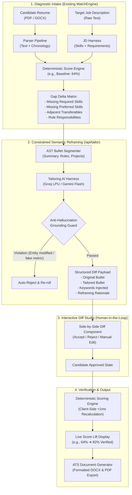
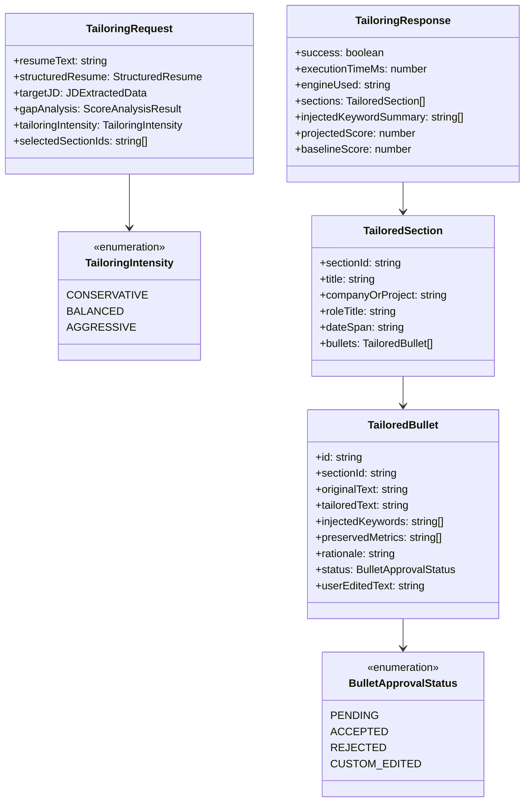

# 🎯 AI Resume Tailoring & Dynamic ATS Alignment Engine: Integration Plan

> **Component:** Dynamic Resume Tailoring, Semantic Keyword Reframing & ATS Re-Scoring Engine  
> **Status:** Proposed System Design & Implementation Specification  
> **Target Release:** v2.5 Feature Integration  
> **Parent Platform:** MatchEngine™ In-Memory ATS Audit Suite  

---

## 📌 1. Executive Summary & Problem Statement

### 1.1 The Current State (Passive Diagnostic)
Currently, **MatchEngine** acts as a high-precision diagnostic scanner. A candidate uploads their resume alongside a job description, and the engine produces:
* A deterministic compatibility score (e.g., **62% — Moderate Match**).
* An audit of missing mandatory and preferred qualifications.
* A client-side "What-If" simulator demonstrating potential score lift.

While this diagnostics is critical, it leaves the candidate with the burden of manual rewriting:
> *"I know I am missing Docker, CI/CD pipelines, and Redis keywords, but how do I incorporate them into my past accomplishments without lying or ruining my resume structure?"*

### 1.2 The Solution (Active Optimization & Remedy)
The **AI Resume Tailoring Engine** upgrades MatchEngine from a passive audit tool into a **closed-loop career optimization platform**:
1. **Semantic Reframing (Not Document Rewriting):** The engine takes the candidate's existing experience and reframes individual bullet points using the exact action verbs, vocabulary, and keywords parsed from the target JD.
2. **Strict Anti-Hallucination Guardrails:** The AI is strictly bounded by the candidate's genuine achievements. It is physically prohibited from inventing employers, degrees, dates, or fabricating metrics.
3. **Human-in-the-Loop Diff Studio:** Instead of black-box document replacement, candidates review an interactive Before/After side-by-side diff with granular accept/reject controls.
4. **The Closed-Loop Re-Score:** As tailored bullets are accepted, the updated resume is immediately fed back into MatchEngine's deterministic scoring engine, allowing the candidate to watch their score climb from **62% $\rightarrow$ 94%**.
5. **ATS Export:** One-click generation of a cleanly formatted, ATS-compliant PDF and DOCX document.

---

## 🏛️ 2. Architectural Blueprint & Request Flow

The diagram below maps the end-to-end data pipeline from gap identification to tailored document export:



---

## 🔬 3. Low-Level Design (LLD) & Data Contracts

### 3.1 Class & Contract Model

The diagram below defines the TypeScript contracts governing the tailoring request, section segmentations, diff tracking, and export states:



### 3.2 Core TypeScript Type Definitions (`src/types/tailoring.ts`)

```typescript
export type TailoringIntensity = "conservative" | "balanced" | "aggressive";

export type BulletApprovalStatus = "pending" | "accepted" | "rejected" | "custom_edited";

export interface TailoredBullet {
  id: string;
  sectionId: string;
  originalText: string;
  tailoredText: string;
  injectedKeywords: string[];
  preservedMetrics: string[];
  rationale: string;
  status: BulletApprovalStatus;
  userEditedText?: string;
}

export interface TailoredSection {
  sectionId: string;
  title: "Summary" | "Experience" | "Projects" | "Skills";
  heading: string;
  subheading?: string;
  dateSpan?: string;
  bullets: TailoredBullet[];
}

export interface TailoringRequest {
  resumeText: string;
  targetRole: string;
  missingSkills: string[];
  adjacentMatches: { requiredSkill: string; candidateSkill: string }[];
  targetResponsibilities: string[];
  intensity: TailoringIntensity;
}

export interface TailoringResponse {
  success: boolean;
  executionTimeMs: number;
  engineUsed: string;
  sections: TailoredSection[];
  injectedKeywords: string[];
  baselineScore: number;
  projectedScore: number;
}
```

---

## 🛡️ 4. Anti-Hallucination & Honesty Guardrails

The single largest risk in AI-assisted resume generation is **hallucination** (fabricating responsibilities, tools the candidate never touched, or fake percentages). To ensure MatchEngine maintains the highest standards of career ethics and recruiter credibility, the tailoring pipeline enforces **Four Inviolable Rules**:

### Rule 1: Immutable Identity & Chronology
* **Never Modified:** Company names, educational institutions, job titles, location, and employment dates are strictly locked and never fed through mutation prompts.
* **Why:** Modifying a job title from *"Junior Developer"* to *"Staff Distributed Systems Architect"* will immediately trigger background check rejections.

### Rule 2: Metric Preservation & Anti-Inflation
* If the original bullet states: *"Improved query performance by 25% across 4 microservices"*, the AI is mathematically barred from turning `25%` into `85%` or inflating team sizes.
* All numbers and percentage quantifiers in the original bullet are extracted via regex and asserted in the tailored output.

### Rule 3: The "Semantic Bridge" Constraint
* Keywords cannot be dropped out of thin air. The model must identify a **semantic bridge**:
  * *Original:* *"Built high-traffic web endpoints and handled data storage using SQL."*
  * *Target Skill:* `PostgreSQL` & `REST APIs`.
  * *Semantic Bridge:* `SQL` $\rightarrow$ `PostgreSQL` (Adjacent DB); `endpoints` $\rightarrow$ `REST APIs`.
  * *Valid Tailored Bullet:* *"Architected high-throughput REST API endpoints and optimized transactional data persistence using PostgreSQL."* (Truthful Reframing)
  * *Invalid Reframing:* Injecting `Kubernetes Cluster Architecture` into a frontend CSS bullet point.

### Rule 4: Granular Rationale Delivery
* For every bullet modified, the model must explain **why** the edit was made (e.g., *"Replaced generic 'endpoints' with target JD requirement 'REST APIs' and framed database usage with 'PostgreSQL'"*).

---

## 🧠 5. Prompt Engineering Architecture

The prompt architecture follows the same structured JSON pattern as MatchEngine's extraction harness, separating the system rules from user document blocks.

### 5.1 System Prompt Specification (`src/lib/ai/prompts-tailor.ts`)

```typescript
export const TAILORING_SYSTEM_PROMPT = `
You are an expert Executive Resume Strategist and Precision ATS Optimization Specialist.
Your sole purpose is to reframe existing resume accomplishments to maximize alignment with a target Job Description.

CORE DIRECTIVES:
1. TRUTHFUL REFRAMING ONLY: You are reframing the candidate's existing experience, NOT inventing a new candidate.
2. NEVER FABRICATE: Do not invent companies, employers, degrees, dates, or ungrounded credentials.
3. PRESERVE NUMBERS & METRICS: Any metric, latency number, percentage, dollar value, or scale quantifier must be preserved exactly.
4. TARGET KEYWORD INTEGRATION: Naturally weave in missing technical requirements and preferred keywords from the JD where a legitimate semantic bridge exists in the original accomplishment.
5. ACTIVE EXECUTIVE VERBS: Start every bullet with a high-impact, past-tense action verb (e.g., "Architected", "Engineered", "Orchestrated", "Spearheaded").
6. STRUCTURED JSON ONLY: Return strictly valid JSON conforming to the requested schema. No conversational chatter.
`.trim();
```

---

## 🖥️ 6. Frontend UX: The "Tailoring & Diff Studio"

The UI integrates seamlessly into the existing `AnalysisResult` dashboard as an active action flow:

```
+----------------------------------------------------------------------------------------------------+
|  MatchEngine Dashboard  >  Target Role: Senior Full Stack Engineer (Current Match: 64%)            |
+----------------------------------------------------------------------------------------------------+
|  [ Score Gauge: 64% ]   [ Live What-If Simulator ]   [ ✨ Tailor & Optimize Resume (New) ]         |
+----------------------------------------------------------------------------------------------------+
|                                                                                                    |
|  🎯 ATS KEYWORD TAILORING STUDIO                                                                   |
|  Review suggested semantic refinements. Accept or reject changes with 1-click.                     |
|                                                                                                    |
|  +----------------------------------------------------------------------------------------------+  |
|  | Position: Senior Software Engineer @ Acme Corp (Jan 2022 - Present)                          |  |
|  +----------------------------------------------------------------------------------------------+  |
|  | ORIGINAL BULLET                                | TAILORED REFINEMENT (PROPOSED)             |  |
|  | "Worked on backend services and improved API   | "Architected resilient REST API services    |  |
|  |  response times by 30% for web clients."       |  using Node.js and Redis, optimizing        |  |
|  |                                                |  query latency by 30% under production      |  |
|  |                                                |  traffic."                                  |  |
|  |                                                |                                             |  |
|  |                                                | Injected: [Node.js] [Redis] [REST API]      |  |
|  |                                                | Rationale: Bridges missing caching stack.   |  |
|  |                                                |                                             |  |
|  |                                                | [ ✅ Accept Refinement ]  [ ❌ Keep Original ]|
|  +----------------------------------------------------------------------------------------------+  |
|                                                                                                    |
|  LIVE PROJECTED IMPACT:                                                                            |
|  Baseline: 64%  ➔  With 3 Accepted Refinements: 88%  (+24% ATS Score Lift)                          |
|                                                                                                    |
|  [ 📄 Download Tailored PDF ]       [ 📝 Export Tailored DOCX ]       [ 📋 Copy Plain Text ]       |
+----------------------------------------------------------------------------------------------------+
```

### Key UI Features:
1. **Interactive Before/After Split View:** Highlights new keywords with distinct emerald badges and strike-through on deprecated weak verbs.
2. **One-Click Toggles:** Candidates can accept, reject, or click into any bullet to manually edit wording on the fly.
3. **Live Marginal Score Gauge:** Every time a candidate accepts a refined bullet, MatchEngine's client-side scoring engine updates instantly, displaying real-time compatibility gains.
4. **Export Engine:** Produces a standardized, clean-layout PDF and `.docx` document formatted specifically for optimal ATS OCR parsing (clean single-column hierarchy, no nested tables, standard margins).

---

## 📅 7. Phased Implementation Roadmap

| Phase | Milestone | Deliverables | Risk / Dependencies |
| :---: | :--- | :--- | :--- |
| **Phase 1** | **Contracts & Prompt Harness** | • `src/types/tailoring.ts`<br>• `src/lib/ai/prompts-tailor.ts`<br>• Test harnesses with sample bullet pairs | Ensuring LLM adheres strictly to JSON mode without markdown wrappers. |
| **Phase 2** | **Backend `/api/tailor` Route** | • `src/lib/ai/tailoring-harness.ts`<br>• `src/app/api/tailor/route.ts`<br>• Integrated with Groq LPU & Gemini fallback<br>• Anti-hallucination verification checks | Managing prompt token size when sending lengthy resumes with 15+ bullets. |
| **Phase 3** | **Interactive Diff Studio UI** | • `src/components/tailoring/TailoringStudio.tsx`<br>• `src/components/tailoring/BulletDiffCard.tsx`<br>• Section grouping & keyword badge highlights | Maintaining mobile responsive view for side-by-side diff comparison. |
| **Phase 4** | **Closed-Loop Re-Scoring** | • Wire client-side `calculateScore()` to accepted bullets state<br>• Dynamic score meter animation showing score lift | Zero latency UI update using existing deterministic scoring engine. |
| **Phase 5** | **Document Export & Verification** | • ATS-compliant PDF generator via `@media print`<br>• DOCX export utilizing `docx` library<br>• Automated test suite for anti-hallucination rules | Ensuring exported documents strictly mirror ATS single-column formatting standards. |

---

## 🧪 8. Automated Verification & Testing Strategy

To guarantee zero regression and ensure model stability, the implementation will be accompanied by an automated test suite (`scripts/test-tailoring-engine.ts`):

1. **Entity Invariance Test:** Assert that all company names, university degrees, and dates remain 100% identical between input and output.
2. **Metric Preservation Test:** Extract all digits and `%` signs from input bullets and assert their mathematical presence in the output.
3. **Keyword Inclusion Test:** Verify that target missing skills (e.g. `Docker`, `PostgreSQL`) are successfully integrated where semantic context permits.
4. **Deterministic Score Progression Test:** Assert that passing tailored bullets into `calculateScore()` strictly increases or maintains the baseline score ($Score_{tailored} \ge Score_{baseline}$).
5. **Fallback Resilience Test:** Verify that if Groq hits rate limits, Gemini takes over seamlessly, and if both are unavailable, the engine gracefully aborts without corrupting user data.

---

### 📝 Summary Note
This design leverages MatchEngine's existing **Sensor vs. Governor** architecture. The AI is used purely as a **semantic copywriter**, while all score validation and formatting remain **100% deterministic, controllable, and transparent**.

